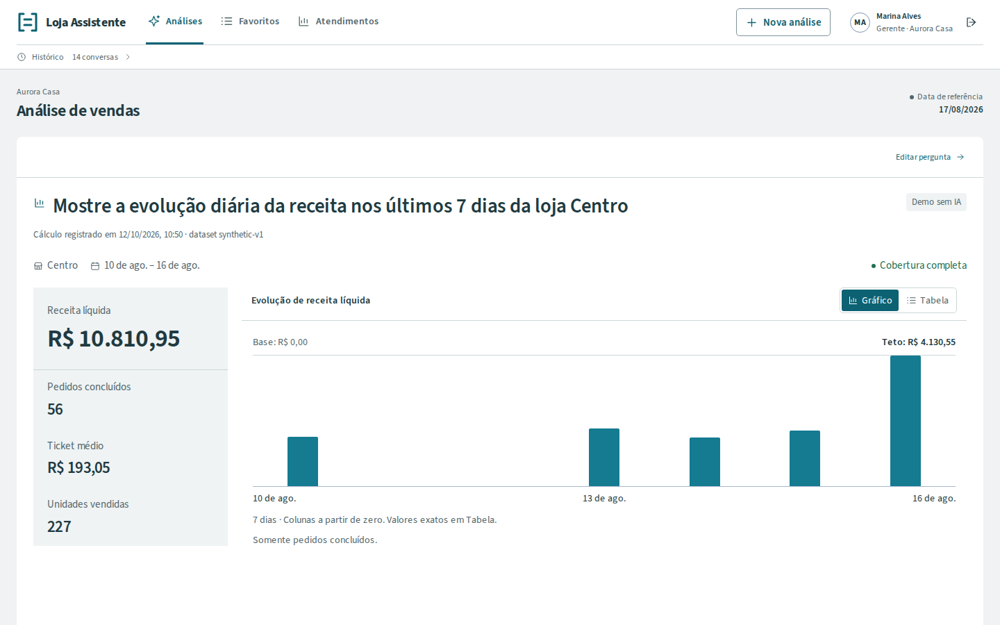
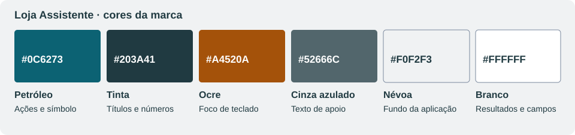
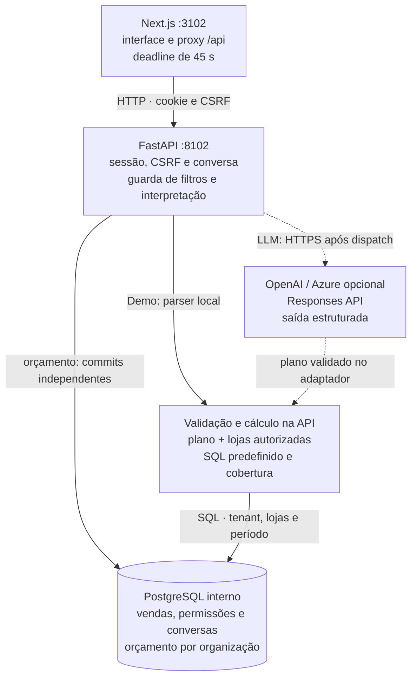
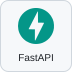

# Loja Assistente

Assistente para consultar vendas em português e conferir quais lojas, período e cálculo a resposta usou. Desenvolvi a interpretação das perguntas, a autorização e as consultas, além da interface, com vendas fictícias. O modo Demo funciona sem chamadas a um modelo.

<!-- Navegação do README -->
<p>
  <a href="#demonstração"></a>
  <a href="#arquitetura"></a>
  <a href="#executar-localmente"></a>
  <a href="#verificação-e-evidências"></a>
  <a href="https://www.linkedin.com/in/arthur-joanes-6a2967373/"></a>
</p>

## Visão geral

A pergunta vira um plano limitado, que o servidor autoriza antes de calcular. A pergunta “Quanto vendi ontem somente em dinheiro?” pede esclarecimento porque forma de pagamento não existe no contrato. A resposta precisa respeitar o recorte pedido e calcular a soma corretamente.

| Responsabilidade       | Implementação                                                               |
| ---------------------- | --------------------------------------------------------------------------- |
| Interpretar a pergunta | Parser determinístico no modo Demo; provedor opcional no modo LLM           |
| Autorizar o recorte    | Organização, usuário e lojas conferidos no servidor, inclusive no histórico |
| Calcular               | Consultas predefinidas, centavos/Decimal e cobertura de loja/dia            |
| Conferir               | Texto, gráfico, tabela e cálculo consultável usam o mesmo resultado         |

O código separa [interpretação](backend/src/loja_assistente/assistant/interpretation.py), [autorização](backend/src/loja_assistente/auth/service.py), [consultas](backend/src/loja_assistente/analytics/queries.py) e [apresentação](backend/src/loja_assistente/assistant/presentation.py).

<a id="na-prática"></a>

## Demonstração



_Aplicação real em Demo, com vendas fictícias de Centro e referência analítica de 17/08/2026. A [comparação antes/depois](docs/uiux-20261012.md) e a [galeria](docs/image-captures.md) identificam fontes, estados, viewports e limites de cada captura. As imagens históricas conservam seus arquivos e hashes._

Esta captura de 12/10/2026 mostra os indicadores e o gráfico de 10–16/08. A [captura com Cálculo aberto](docs/screenshots/uiux-20261012/after-chromium-resultado-1440-focus.png) mostra a fórmula, a cobertura 7/7 e as sete linhas diárias que somam R$ 10.810,95.

<a id="uma-conta-pequena-e-um-caso-de-consulta"></a>

Na fixture de testes `manual-v1`, **“Quanto vendi ontem?”** usa a referência de 17/08/2026 e consulta Centro A em 16/08:

| Pedido concluído | Conta                                       |   Receita | Unidades |
| ---------------- | ------------------------------------------- | --------: | -------: |
| `oa3`            | 2 garrafas × R$ 6 − R$ 2 + 5 ecobags × R$ 2 |     R$ 20 |        7 |
| `oa4`            | 1 caneca × R$ 10                            |     R$ 10 |        1 |
| Total            | 2 pedidos distintos                         | **R$ 30** |    **8** |

Ticket médio: **R$ 30 / 2 = R$ 15**. Pedido cancelado e vendas de outra organização ficam fora. A [fixture independente](backend/tests/manual_fixture.py) permite refazer os [resultados esperados](evals/cases/manual-v1.json) usados pelos [testes analíticos](backend/tests/test_analytics.py). A massa `synthetic-v1` da interface é outra base: seus totais não devem ser comparados com esta conta manual.

<a id="conferir-uma-análise"></a>

Na interface, peça **Mostre a evolução diária da receita nos últimos 7 dias**, alterne **Gráfico/Tabela** e abra **Cálculo**. Confira lojas, período e cobertura. Selecionar um resultado antigo muda a leitura; a continuação usa o último plano válido da conversa. [Roteiro](docs/demo.md) · [Interface e fontes](docs/interface.md).

Salve um cálculo válido em **Favoritos** para repetir seu plano nas mesmas datas absolutas. **Abrir cálculo registrado** conserva a evidência original; **Executar novamente** consulta a base atual e registra outra resposta. O servidor confere as permissões a cada acesso. Se perguntar **Receita da loja Centro** sem período, escolha o período no esclarecimento: o indicador e a loja permanecem selecionados, inclusive após atualizar a página. [Contratos e estados](docs/api-contract.md#favoritos-e-esclarecimentos).

A escolha pendente aparece antes da resposta e permanece disponível quando o editor da próxima consulta está recolhido no celular. O escopo destaca nomes das lojas e dias incluídos; IDs e fim exclusivo ficam em detalhe conferível. Erros conservam a pergunta e, após conflito de renomeação, recarregar mantém o nome digitado. [Jornadas, decisões e validação de UI/UX](docs/uiux-20261012.md).

A [revisão de UI/UX de 12/10/2026](docs/verification.md#uiux-de-12102026) reúne a rodada principal de evidências históricas. O [recibo](docs/evidence/uiux-20261012/index.json) identifica a versão testada e as capturas; os resultados abaixo não abrangem alterações posteriores.

| Rodada histórica | Escopo registrado | Proveniência |
| --- | --- | --- |
| UI/UX · 12/10/2026 | 477 backend; 57/57 offline; 85 Playwright (41 puros/proxy e 44 navegador/HTTP) | [Recibo principal](docs/evidence/uiux-20261012/index.json) |
| Favoritos e esclarecimentos · 12/10/2026 | 477 backend; 57/57 offline; 79 Playwright | [Verificação da evolução](docs/verification.md#evolução-de-12102026) |
| CI · 22/09/2026 | 69 Playwright: 39 puros e 30 navegador/HTTP | [Recibo do CI](docs/evidence/frontend-ci-20260922.json) |

As rodadas têm commits e escopos próprios; suas contagens não são somadas. O [guia de verificação](docs/verification.md) centraliza comandos, versões e limites. O [comando isolado](docs/local-setup.md#verificação-isolada-da-evolução) prepara fontes, imagens e bancos exclusivos por rodada.

## Identidade visual



Petróleo identifica ações e o símbolo; tinta escura sustenta títulos e dinheiro; cinza azulado acompanha explicações. Névoa e branco separam o fundo dos resultados. Ocre destaca o foco de teclado, com a exceção do campo Pergunta, que conserva foco petróleo. A interface usa Source Sans 3 local, com [licença OFL](frontend/src/app/fonts/source-sans-LICENSE.md). [Cores, usos e contraste](docs/uiux-20261012.md#paleta-da-marca).

## Arquitetura



Interpretação, orçamento e cálculo executam no mesmo backend FastAPI. Todas as consultas terminam no ciclo HTTP; as setas pontilhadas indicam apenas o caminho LLM opcional, também síncrono. Não há worker ou fila de perguntas. O modelo recebe pergunta, lojas permitidas, datas e último plano autorizado; o servidor resolve as referências, revalida o plano e calcula.

| Etapa | Responsabilidade e fronteira |
| --- | --- |
| [Entrada e conversa](backend/src/loja_assistente/assistant/service.py) | Deriva identidade da sessão; trava a conversa com `NOWAIT`, reautoriza contexto e registra a resposta |
| [Interpretação](backend/src/loja_assistente/assistant/interpretation.py) | Recusa filtros fora do contrato antes de consultar ou chamar o provedor; Demo usa parser local |
| [Orçamento LLM](backend/src/loja_assistente/assistant/budget.py) | Confirma reserva e despacho em transações próprias; timeout conserva consumo incerto, sem retry automático |
| [Cálculo e apresentação](backend/src/loja_assistente/analytics/service.py) | Reconsulta permissões, usa cobertura por loja/dia e centavos/Decimal; texto, gráfico e tabela partem do mesmo resultado |

O [Compose](compose.yaml) publica frontend/API em loopback e mantém o banco interno. Migração e seed preparam a massa antes da demonstração. O [guia de arquitetura](docs/architecture.md) abre os módulos, o modelo de dados e a sequência dos commits antes e depois do provedor.

<a id="implementação"></a>
<a id="o-que-eu-implementei"></a>
<a id="stack"></a>
<a id="interpretação-e-cálculo-separados"></a>

## Stack e decisões

<p>
  
  
  
  
  
  
  
</p>

| Camada          | Escolha e compromisso                                                |
| --------------- | -------------------------------------------------------------------- |
| Interface       | Next.js, React e TypeScript; gráfico/tabela sem recalcular dinheiro  |
| API             | Python/FastAPI, SQLAlchemy e consultas parametrizadas                |
| Dados           | PostgreSQL; autorização, cobertura e precisão financeira no servidor |
| Modelo opcional | SDK OpenAI, com saída estruturada validada novamente pelo domínio    |
| Execução        | Docker Compose; demo, testes e avaliação usam escopos distintos      |

Esquema válido não comprova interpretação correta ou autorização. A [Microsoft documenta a saída estruturada](https://learn.microsoft.com/en-us/azure/foundry/openai/how-to/structured-outputs); este projeto valida o [plano](backend/src/loja_assistente/analytics/contracts.py) e as [permissões](backend/src/loja_assistente/auth/service.py) separadamente. [Decisões e alternativas](docs/decisoes-tecnicas.md) · [Lock Python](backend/uv.lock) · [Lock frontend](frontend/package-lock.json).

<a id="executar-e-verificar"></a>
<a id="rodar"></a>

## Executar localmente

Docker Desktop com containers Linux e PowerShell 7+; na raiz:

```powershell
.\scripts\dev.ps1 setup
.\scripts\dev.ps1 start
```

Após o [setup](scripts/dev.ps1), abra a [interface](http://localhost:3102) ou a [API](http://localhost:8102/docs). O [seed](backend/src/loja_assistente/seed.py) cria a conta fictícia `gerente.a@demo.local`, senha `LojaDemo!2026`; a [configuração](backend/src/loja_assistente/config.py) exige `DEMO_MODE=true`. O relógio analítico padrão é 17/08/2026.

Demo dispensa chave e chamadas pagas; a execução local continua consumindo recursos do computador. [Linux e operação](docs/local-setup.md). O modo LLM exige [configuração do provedor](docs/llm-integration.md) e [orçamento por organização](docs/provider-budget.md); pode gerar cobrança.

<a id="dá-pra-conferir-sem-rodar"></a>
<a id="testes"></a>

## Verificação e evidências

Confira a avaliação histórica sem Docker, chave ou rede, com Python 3.11+:

```sh
python scripts/verify_evidence.py
```

O [verificador](scripts/verify_evidence.py) recalcula hashes, contagens e custo estimado dos artefatos. O [resumo da execução Azure de **21/09/2026**](evals/reports/20260921T121255Z-a9c11d1f/summary.json) registra **47/48** tentativas aprovadas no caminho modelo + backend, contra **24/48** do parser: 24 perguntas repetidas duas vezes. São dados sintéticos e uma amostra limitada, com uma falha preservada nos [casos executados](evals/reports/20260921T121255Z-a9c11d1f/cases.jsonl).

As três etapas registraram **55 chamadas e 48.788 tokens**. O custo **estimado histórico** de **US$ 0,01550395** usa uma hipótese conservadora de entrada, não uma fatura ou cotação atual. [Medidores e datas](docs/evidence/azure-live/azure-prices.json) · [Cálculo, preços e limites](docs/azure-live-results.md#chamadas-e-consumo). O teto de US$ 15 daquela avaliação não limita a conta Azure nem a interface.

```powershell
.\scripts\dev.ps1 test
.\scripts\dev.ps1 e2e
```

Consulte a tabela de rodadas acima e o [guia de verificação](docs/verification.md) para relacionar cada resultado ao seu commit e escopo.

<a id="limites-e-manutenção"></a>
<a id="limites"></a>

## Limites e segurança

- O [contrato](backend/src/loja_assistente/analytics/contracts.py) aceita uma métrica por pergunta; pagamento, vendedor, categoria, produto específico e horário são [filtros não suportados](backend/src/loja_assistente/assistant/filter_limits.py). Ranking de produtos é uma capacidade distinta.
- Comparações exigem [cobertura completa](backend/src/loja_assistente/analytics/queries.py); dia ausente não vira venda zero.
- Lucro, estoque, imposto e reembolso parcial não são modelados.
- A [política de orçamento](backend/src/loja_assistente/assistant/budget_policy.py) controla admissão; não garante cobrança monetária do provedor.
- A demonstração não comprova produtividade, capacidade de produção, acessibilidade integral ou segurança universal. Publicação exige identidade, HTTPS e proteção operacional próprios.

O guia de [segurança](docs/security.md) detalha os limites de rede e das verificações. A [revisão de 03/10/2026](docs/SECURITY-REVIEW-2026-10-03.md) registra os 18 itens do checklist, as correções e a dependência de desenvolvimento que ainda aguarda correção do fornecedor.

<a id="manter-e-diagnosticar"></a>

## Documentação

| Para entender ou fazer         | Guia                                                                                                                   |
| ------------------------------ | ---------------------------------------------------------------------------------------------------------------------- |
| Percorrer problema e resultado | [Problema e solução](docs/problem-solution.md) · [Demo](docs/demo.md)                                                  |
| Conferir o que é calculado     | [Métricas](docs/metrics.md) · [Dados](docs/data-contract.md) · [HTTP](docs/api-contract.md)                            |
| Entender a implementação       | [Arquitetura](docs/architecture.md) · [Decisões](docs/decisoes-tecnicas.md)                                            |
| Usar o provedor                | [Integração](docs/llm-integration.md) · [Orçamento](docs/provider-budget.md) · [Avaliação](docs/azure-live-results.md) |
| Conferir afirmações e datas    | [Fontes e afirmações](docs/fontes-e-afirmacoes.md)                                                                     |
| Manter e verificar             | [Operação](docs/local-setup.md) · [Testes](docs/verification.md) · [Padrão documental](docs/padrao-documentacao.md)    |

Para diagnosticar, confira `dev.ps1 status`, `dev.ps1 logs` e o `request_id` de **Cálculo**. Relate passos e versão nas [issues](https://github.com/arthurjoanes/loja-assistente/issues), sem chaves ou dados pessoais.

## Autor e licença

Desenvolvido por **Arthur Joanes**. Para conversar sobre análise de vendas, interpretação e dados verificáveis:

<p>
  <a href="https://www.linkedin.com/in/arthur-joanes-6a2967373/">
    
    <strong>Arthur Joanes no LinkedIn</strong>
  </a>
</p>

Código sob [licença MIT](LICENSE). Source Sans 3 mantém a [licença OFL 1.1](frontend/src/app/fonts/source-sans-LICENSE.md) e a [origem](frontend/src/app/fonts/sources.json). Ícones da stack e LinkedIn: [Devicon, licença MIT](docs/stack/LICENSE.devicon).
